  

  

---

## 👋 About Me

MBA-qualified business development and strategy consultant **moving into Machine Learning Engineering**.

- 🍽️ 4 years of business development experience in the **restaurant & F&B sector**
- 🤖 Certified in **Machine Learning A-Z** (Udemy, SuperDataScience — 2026)
- ☁️ Building, automating, and monitoring ML workflows on **AWS**
- 💡 I frame business problems as ML problems — and explain the results to decision-makers
- 🌍 Arabic (Native) · English (Fluent) · German (A2)
- 📍 Cairo, Egypt

---

## 🧠 What I Work On

| Area | Topics |
|------|--------|
| **Machine Learning** | Regression · Classification · Clustering · Association Rule Learning · Reinforcement Learning |
| **Advanced** | NLP · Deep Learning · Dimensionality Reduction (PCA, LDA, Kernel PCA) · Model Selection & XGBoost |
| **MLOps on AWS** | ML Development & Deployment · CI/CD Pipelines · Monitoring & Maintenance |
| **Business** | Go-to-Market Strategy · Feasibility Studies · Financial Modeling · B2B Growth · Market Research |

---

## 🛠️ Tech Stack

  

  
  
  
  
  
  

---

## 🎓 Education & Certification

- 🏅 **Machine Learning A-Z: ML, DL, AI with AWS & Python** — Udemy, SuperDataScience · 49.5 hrs · Oct 2026
  [View credential](https://ude.my/UC-4a4fad90-7b21-4dd7-b2ca-e6ed757c9feb)
- 🎓 **MBA — Technology Management & Strategic Business Growth** — AASTMT, Cairo · 2023

---

## 💼 Experience Highlights

**Business Development Consultant** — Restaurant & F&B Sector · 2022 – Present
- ⚙️ Automated reporting & forecasting workflows — **cut manual analysis time by 40%**
- 📊 Data analysis & market research for go-to-market strategies of new F&B concepts
- 🤝 Negotiated B2B agreements and strategic alliances with regional tech providers
- 📈 Built feasibility studies & financial models to support go / no-go decisions

---

## 📊 GitHub Stats

  
  

---

## 📫 Let's Connect

  
  

  

